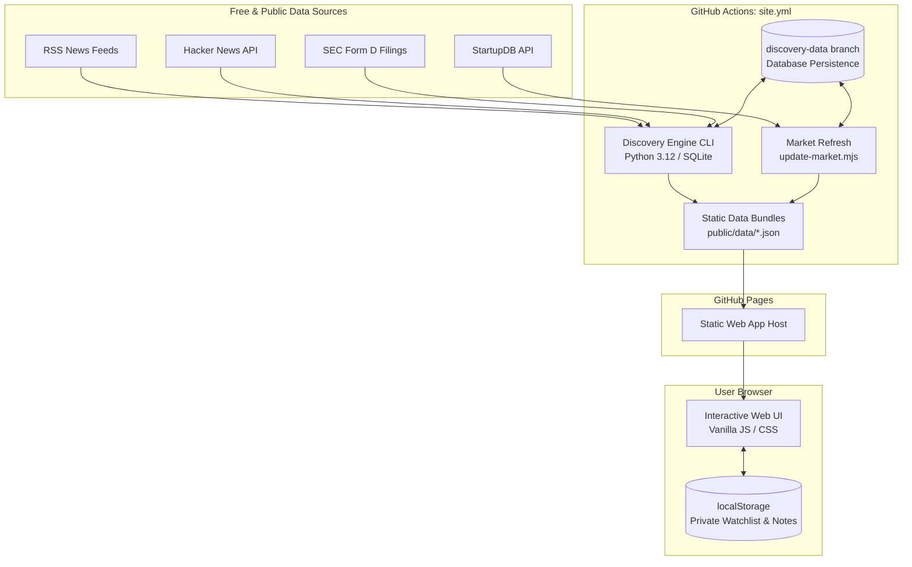

# VentureScout

[](https://github.com/BagofRamen27/Venture-capital-tracker-/actions/workflows/tests.yml)
[](https://github.com/BagofRamen27/Venture-capital-tracker-/actions/workflows/site.yml)
[](LICENSE)

**Open-source startup discovery, reported funding, news, and personal research lists.**
Free to run: a static website on **GitHub Pages**, refreshed once a day by **GitHub Actions**.
No servers, no paid services, no sign-in.

Live site: [https://bagoframen27.github.io/Venture-capital-tracker-/](https://bagoframen27.github.io/Venture-capital-tracker-/)

## What's in this repository

| Component | Path | Description |
|---|---|---|
| Website Frontend | [`vc-investment-tracker-web/`](vc-investment-tracker-web/README.md) | Static dashboard and research UI: Discover, My startups, Dashboard, Directory, Scorecard, Deal pipeline, Financials, Data status |
| Python Discovery Engine | [`discovery-engine/`](discovery-engine/README.md) | Local/scheduled research engine: finds startups in news feeds, Hacker News, and SEC Form D filings, validates evidence, and generates scores |
| Site Update Workflow | [`.github/workflows/site.yml`](.github/workflows/site.yml) | Daily scheduled workflow: runs discovery extraction, refreshes market data, exports static JSON, and publishes to GitHub Pages |
| CI Test Suite | [`.github/workflows/tests.yml`](.github/workflows/tests.yml) | Continuous integration workflow: runs all unit, integration, and syntax checks on pushes and pull requests |

## Architecture and System Design

VentureScout operates as a serverless static site decoupled from an offline/scheduled discovery engine. The pipeline processes public data sources into static JSON snapshots, while private user state remains strictly in client-side browser storage:



For detailed pipeline flows, component breakdown, data models, and deployment configurations, refer to the [System Architecture Guide](docs/architecture.md).

## One-time setup (about 5 minutes)

1. **Turn on GitHub Pages:** repository **Settings → Pages → Build and deployment → Source: GitHub Actions**.
2. **Add your SEC contact** (the SEC requires a name and email for automated access):
   **Settings → Secrets and variables → Actions → New repository secret**,
   name `VCD_SEC_USER_AGENT`, value `Your Name your.email@example.com`.
   Without it, everything except SEC Form D data still works.
3. **Run it once now:** **Actions → Update data and publish site → Run workflow**. It takes about 5–10 minutes,
   then the site is live at the address above. After that it updates itself every day at 07:17 UTC.

GitHub pauses scheduled jobs in repositories with no activity for 60 days. If that happens, GitHub emails
you; click **Enable workflow** on the Actions tab.

## Local Development and Testing

Both components can be run and tested locally without any paid third-party API keys or external services.

### Frontend Website (`vc-investment-tracker-web`)

Requires **Node.js >= 20.11**. Uses vanilla JavaScript and CSS with no external npm runtime dependencies.

```bash
cd vc-investment-tracker-web

# Start local development server (serves at http://127.0.0.1:3010)
npm run dev

# Run unit tests (28 test assertions covering market parsing, sanitization, and UI utilities)
npm test

# Run syntax and static validation checks
npm run check

# Build production bundle
npm run build
```

### Python Discovery Engine (`discovery-engine`)

Requires **Python >= 3.10** (CI uses Python 3.12).

```bash
cd discovery-engine

# Create and activate virtual environment
python3 -m venv .venv
source .venv/bin/activate       # On Windows: .venv\Scripts\activate

# Install dependencies
pip install -r requirements.txt

# Copy environment template and configure SEC user agent
cp .env.example .env            # On Windows: copy .env.example .env

# Initialize database and run first discovery pass
python -m vcdiscovery.cli init-db
python -m vcdiscovery.cli run

# Start local research API (FastAPI server at http://127.0.0.1:8000)
python -m vcdiscovery.cli serve

# Run test suite (109 unit and integration tests)
python -m pytest
```

## How your data is stored

- **Discovered companies, news and funding data** are public-source data, rebuilt daily and published with the site.
  The discovery database is kept between runs on the `discovery-data` branch.
- **My startups, scores and pipeline edits** stay in your own browser. They are private to that browser and
  don't sync between devices. Use **My startups → Back up** to download a copy and **Restore backup** to load it elsewhere.

## Documentation and Community Standards

- **[System Architecture Guide](docs/architecture.md)** — Architectural design, pipeline flows, and deployment models.
- **[StartupDB Market Policy](docs/market-policy.md)** — Funding refresh procedures, fail-safe snapshot retention, and data validation semantics.
- **[Contribution Guidelines](CONTRIBUTING.md)** — Local development setup, coding conventions, testing requirements, and PR process.
- **[Code of Conduct](CODE_OF_CONDUCT.md)** — Contributor Covenant v2.1 community standards and reporting guidance.
- **[Security Policy](SECURITY.md)** — Vulnerability reporting channels and coordinated disclosure policy.

## Contributors

Thank you to everyone helping build and improve VentureScout!

<a href="https://github.com/BagofRamen27/Venture-capital-tracker-/graphs/contributors">
  
</a>

### Hall of Contributors

VentureScout features an on-site **Hall of Contributors** gallery. Everyone who contributes code, documentation, or data research can have their portrait plaque featured on the live site. See [Join the Hall of contributors](CONTRIBUTING.md#join-the-hall-of-contributors) to submit your plaque.

## License and data sources

Application code is licensed under the [MIT License](LICENSE). StartupDB facts are used under CC BY 4.0 with attribution. News headlines link to their original publishers; only headlines and short summaries are stored. Third-party content retains its respective owners' rights.
See [CONTRIBUTING.md](CONTRIBUTING.md) to contribute.
