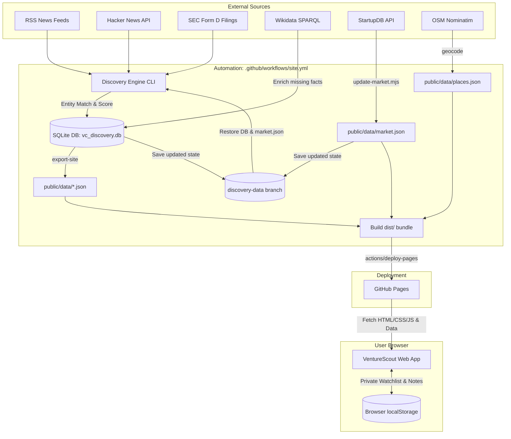

# VentureScout System Architecture

VentureScout is an open-source research platform for discovering early-stage startups, tracking funding events, and analyzing public market signals without paid APIs, third-party databases, or server infrastructure.

This document describes the monorepo architecture, component boundaries, data flow, security model, and automation pipelines.

---

## 1. Architectural Principles

1. **Static-First & Serverless:** The public application deploys as a pure static website to **GitHub Pages**.
2. **Zero Paid APIs:** Ingestion relies exclusively on free, open sources (RSS feeds, SEC Form D, Hacker News, Wikidata, StartupDB, and OpenStreetMap).
3. **Strict Privacy Boundary:**
   - **Public Research Data** is rebuilt daily and published with the static site.
   - **Personal Research Workspaces** (custom notes, pipeline stages, and score overrides) remain stored strictly in the user's browser `localStorage` and are never transmitted to any server.

---

## 2. High-Level System Overview



---

## 3. Monorepo Component Boundaries

```text
Venture-capital-tracker-/
├── discovery-engine/           # Python 3.10+ Discovery Engine & REST API
│   ├── config/                 # Ingestion sources & scoring weight configs
│   ├── data/                   # Local SQLite storage (vc_discovery.db)
│   ├── tests/                  # Automated pytest test suite (109 tests)
│   └── vcdiscovery/            # Core library modules
│       ├── api/                # FastAPI application & serializers
│       ├── sources/            # Connectors (RSS, HN, SEC, Reddit, YouTube)
│       ├── pipeline.py         # Ingestion orchestration & item processing
│       ├── extraction.py       # Rule-based entity extraction
│       ├── funding.py          # Funding round resolution & deduplication
│       ├── scoring.py          # Evidence-based investment thesis scoring
│       ├── site_export.py      # Static JSON export builder
│       └── cli.py              # Administrative command-line interface
├── vc-investment-tracker-web/  # Plain ES Modules & CSS Web Tracker
│   ├── public/                 # Static web assets & views
│   │   ├── app.js              # Primary application router & UI views
│   │   ├── market.js           # StartupDB integration & views
│   │   ├── scout.js            # Personal startup management & storage
│   │   ├── map.js              # Leaflet geocoded map integration
│   │   └── data/               # Generated static data artifacts (git-ignored)
│   ├── scripts/                # Node.js utility scripts (dev, build, update-market)
│   ├── src/                    # Shared Node modules (market adapter)
│   └── test/                   # Automated Node.js test suite (28 tests)
├── .github/workflows/          # GitHub Actions CI/CD workflows
│   ├── site.yml                # Daily data discovery & deployment workflow
│   └── tests.yml               # Automated PR and push test validation
└── docs/                       # Technical specs, policies, and design plans
```

---

## 4. Component Deep Dive

### A. Python Discovery Engine (`discovery-engine/`)
The discovery engine handles data acquisition, natural language rule extraction, entity resolution, and public static file generation:
- **Connector Ingestion:** Fetches public feeds respecting polite intervals and SEC user-agent compliance.
- **Rule-Based Extraction:** Parses company names, round types (Seed, Series A–E), currencies, amounts, and investors without external LLM dependencies.
- **Evidence Labeling:** Tags every funding fact with an evidence classification (`confirmed`, `company-announced`, `reported`, `target`, `rumour`, `regulatory`).
- **Entity Resolution & Deduplication:** Links related news mentions, reconciles SEC Form D filings against company profiles, and identifies potential duplicate candidates.
- **Thesis Scoring:** Evaluates research factors (growth momentum, product differentiation, market opportunity, team profile) with explainable citations.
- **Local Research API:** Serves an interactive FastAPI service on `http://127.0.0.1:8000/docs` with CSV import/export capabilities.

### B. Client-Side Web Tracker (`vc-investment-tracker-web/`)
The frontend is a fast, dependency-free web application:
- **Zero NPM Dependencies:** Standard ES modules, native CSS, and browser APIs.
- **Dynamic Views:**
  - *Discover:* Explores daily discovered companies, evidence status, and scores.
  - *Dashboard & Financials:* Analyzes StartupDB funding histories and classified news.
  - *Map:* Interactive geographic visualization via Leaflet.
  - *My Startups & Deal Pipeline:* Local Kanban board and custom research notes.
  - *Data Status:* Transparency dashboard displaying source health and execution timestamps.
- **Data Persistence:** User workspace edits are stored directly in `localStorage` through `VS.writeSaved()`. An export/import JSON backup tool allows moving research across browsers without server sync.

### C. GitHub Actions Automation (`.github/workflows/`)
- **Daily Orchestration (`site.yml`):** Runs daily at 07:17 UTC. Persists the SQLite database between runs on an orphan `discovery-data` branch, ensuring historical tracking without dedicated database servers.
- **Test Validation (`tests.yml`):** Validates the full Python test suite (`python -m pytest`) and web test suite (`node --test && npm run check`) on all pushes and PRs.

---

## 5. Security & Data Protection Architecture

VentureScout enforces strict security and privacy boundaries:

1. **Credential Sanitization in Health Endpoints:**
   The health API endpoint (`/api/health`) parses database connection strings and exposes only the dialect name (e.g., `'sqlite'`, `'postgresql'`), completely redacting passwords, hostnames, and filesystem paths (merged in PR #26).
2. **Job Error Redaction:**
   Serialization boundaries (`job_dict` and `site_export.py`) sanitize error messages to coarse operational categories (e.g., `HTTP 500`, `Connection failed`, `Request timeout`), preventing query tokens, internal hostnames, and paths from leaking in exported artifacts or API responses (merged in PR #29).
3. **CSV Formula Injection Neutralization:**
   Export endpoints prefix formula trigger characters (`=`, `+`, `-`, `@`) with a single quote to prevent spreadsheet code execution.
4. **Photo Privacy in Contributor Gallery:**
   Submitted contributor portraits are cropped to 4:5, compressed, and stripped of camera EXIF and GPS location metadata before publication.

---

## 6. Local Development Workflows

### Web Application
Requires **Node.js >= 20.11**. No `npm install` needed.

```bash
cd vc-investment-tracker-web
npm run dev        # Local preview on http://127.0.0.1:3010
npm test           # Executes 28 Node tests
npm run check      # Validates JavaScript syntax
npm run build      # Compiles static bundle to dist/
```

### Discovery Engine
Requires **Python >= 3.10**.

```bash
cd discovery-engine
python -m venv .venv
source .venv/bin/activate       # Windows: .venv\Scripts\activate
pip install -r requirements.txt
python -m pytest                # Executes 109 Python tests
python -m vcdiscovery.cli init-db
python -m vcdiscovery.cli serve # Starts REST API on http://127.0.0.1:8000
```
